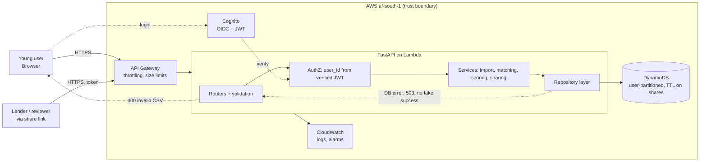

# Credit Gym: Architecture and Implementation Plan

## 1. Architecture summary

**Core function:** turn a young person's everyday financial behaviour (bills paid on time, regular savings) into a transparent **Credit Readiness Score** and a **consented, shareable credibility report**. It is not a bureau score, and the app must never present it as one.

**Core journey:** sign up → pick a goal (e.g. first phone contract) → upload a bank statement CSV and define "workouts" (recurring commitments) → system matches transactions to commitments → score, streaks and next actions → generate an expiring report link.

| MVP (build) | Defer |
|---|---|
| Auth, CSV import, commitments, rule-based scoring, dashboard, share link, delete-my-data | Open-banking verification, bureau reporting, lender portal, LLM coaching, notifications, mobile app |

**Key decisions:**
- One FastAPI app serves both the API and the UI (Jinja2 + HTMX). There is one deployable and no CORS problem.
- Scoring is deterministic rules, so it's explainable and testable. No AI in the critical path.
- The CSV is parsed in-request and the raw file is never stored. Only normalised transactions are kept (data minimisation).
- The score is labelled **"self-reported"** until bank-verified. Uploaded CSVs can be edited, and the product must say so.

## 2. Technology stack

| Layer | Choice | Why |
|---|---|---|
| Frontend | Jinja2 + HTMX + Chart.js | Python-only, no build step, fast for one person |
| Backend | FastAPI + Pydantic, on Lambda via Mangum | Typed validation, cheap, scales to zero |
| Database | DynamoDB (on-demand), single table | Every query is "all data for one user", so the partition key doubles as access control |
| Auth | Cognito user pool, hosted UI (OIDC) | No custom password handling |
| External APIs | None for MVP | Fewer failure points |
| Testing | pytest, moto, hypothesis, Playwright (1 test) | Mocked AWS, fuzzed parser |
| Deployment | AWS SAM, API Gateway HTTP API, GitHub Actions | One `sam deploy` |
| Monitoring | CloudWatch logs and alarms, structured JSON logs | Free tier is enough |

**Costs and risks:**
- Everything fits the free tier or costs cents at demo scale.
- Lock-in is moderate (Cognito and DynamoDB). Repository interfaces keep the data layer swappable.
- **Data residency:** prefer `af-south-1` (Cape Town) for POPIA. Check that each service is available there. If any isn't, use synthetic or consented demo data only.

## 3. Architecture diagram



**Components:**
- **API Gateway:** rate limits and the 1 MB body cap.
- **Routers:** validate input and map errors to safe responses.
- **AuthZ:** the user ID comes only from the verified token, never from the request.
- **Services:** hold the business rules and know nothing about HTTP.
- **Repository:** the only code that touches DynamoDB.
- **Cognito:** handles identity.
- **Share route:** the one public surface, and it is read-only.

## 4. Codebase structure

```
credit-gym/
├─ app/
│  ├─ main.py              # app factory, middleware, handler (Mangum)
│  ├─ config.py            # env settings (pydantic-settings)
│  ├─ api/                 # routers: statements, score, commitments, reports, me
│  ├─ web/                 # templates/, static/ (presentation only)
│  ├─ core/                # PURE business logic, no AWS or FastAPI imports
│  │  ├─ models.py         # dataclasses/Pydantic domain types
│  │  ├─ csv_parser.py     # normalise bank CSV → Transaction[]
│  │  ├─ matcher.py        # commitments ↔ transactions
│  │  └─ scoring.py        # readiness score + explanations
│  ├─ services/            # orchestration: import, report sharing
│  ├─ repositories/        # base.py (interface), dynamo.py, memory.py
│  ├─ security/            # jwt verify, share-token signing, rate-limit helpers
│  └─ observability/       # JSON logger, redaction
├─ tests/ (unit/, integration/, security/, e2e/, fixtures/)
├─ template.yaml           # SAM
├─ .github/workflows/ci.yml
└─ pyproject.toml, requirements.lock
```

**Dependency direction:** `api → services → core` and `services → repositories`. `core` depends on nothing. `core` and the in-memory repository can be built and tested before any AWS setup exists.

## 5. API contracts and data model

| Endpoint | Purpose | Key response |
|---|---|---|
| `POST /api/commitments` | `{name, type: bill\|savings, amount, due_day}` | `201 {id}` |
| `POST /api/statements` | multipart CSV (≤1 MB) | `{imported, duplicates, rejected[]}` |
| `GET /api/score` | current score | `{score, components, history, data_basis: "self_reported", as_of}` |
| `POST /api/reports` | needs `Idempotency-Key` header | `{url, expires_at}` (7 days) |
| `GET /r/{token}` | public, read-only | score, components, basis, date. No raw transactions. |
| `DELETE /api/me` | erase all user data | `204` |

**Score (0–100, weights shown on screen):** on-time payments 45, savings consistency 30, account stability (no overdrafts or returned debits) 15, history length 10.

**Single table `credgym`:**
- `PK=USER#<id>`, `SK=PROFILE`
- `SK=COMMIT#<id>`
- `SK=TXN#<date>#<hash(date,amount,desc)>`, where the hash makes re-upload idempotent
- `SK=SCORE#<yyyymm>`
- `PK=SHARE#<token_hash>`, with a TTL attribute and the `user_id` it points to

## 6. Security and failure matrix

| Risk / failure | Mitigation (where) | Detect / user sees / log | Verify |
|---|---|---|---|
| Unauthenticated access | JWT verification dependency on every `/api` route, deny by default (`security/`) | 401, generic message, log request ID | Test each route without a token |
| Accessing another user's data (IDOR) | `user_id` only from token, repository always takes it as a parameter | 404, log denial | Cross-user tests |
| Malicious or huge CSV, CSV formula injection | Size and row caps, strict column and type checks, strip leading `= + - @` on text (`csv_parser`) | 400 with row-level reasons | Hypothesis fuzzing |
| XSS | Jinja2 autoescape, CSP header | none | Inject `<script>` as a commitment name |
| CSRF | SameSite cookies plus a CSRF token on forms | 403 | Test missing token |
| Share-link guessing or leak | 256-bit random token, store only its hash, 7-day TTL, revocable, minimal fields | 404 on expiry | Test expiry and revocation |
| Secrets exposure | Env vars and SSM Parameter Store, `gitleaks` in CI | CI fails | CI check |
| POPIA | Collect minimum data, explicit consent screen before sharing, delete endpoint, no raw statements stored, region choice | consent timestamp stored | Legal review needed |
| DynamoDB throttling or outage | Boto retries with backoff and a 3 s timeout | 503 "try again", log error class | Failure-path test with moto or fault injection |
| Duplicate or interrupted import | Deterministic txn keys, batched writes | re-upload yields `duplicates=n` | Idempotency test |
| Duplicate report creation | Idempotency-Key | same URL returned | Test |
| Missing config or expired credentials | Fail fast on startup, `/health` shows degraded | 503 | Boot test |
| Unexpected exception | Global handler returns a request ID only, never a stack trace | 500 | Test |

**Remaining risks:**
- Self-reported data can be falsified.
- The score has no lender acceptance.
- Lambda and Cognito misconfiguration is not covered by these tests.
- **Needs independent verification:** a POPIA review and a check of NCA/FSCA applicability. I'm not a lawyer, so confirm this with one.

## 7. Testing plan

| Feature | Behaviour | Failure case | Done when |
|---|---|---|---|
| CSV parser | Normalises 2–3 SA bank formats | Malformed row, formula injection | Fuzz tests pass |
| Matcher | Matches within ±3 days and ±10% amount | Missing or duplicate payment | Unit tests |
| Scoring | Deterministic, bounded 0–100 | Empty history gives "insufficient data", not 0 | Property tests |
| Auth/IDOR | Own data only | Cross-user access | Security tests |
| Share | Valid link works | Expired or revoked gives 404 | Tests |
| Import | Idempotent | DB timeout gives 503 with no partial state | Integration tests (moto) |

Add one end-to-end test (sign in → import → score → share link), and mock all AWS calls in unit tests. CI blocks the merge if ruff, mypy, pytest, pip-audit or gitleaks fail.

## 8. Deployment plan

- **Environments:** `dev` (local, in-memory repository) and `demo` (AWS). A separate prod stage comes later.
- **Deploy:** `sam build && sam deploy` from GitHub Actions. HTTPS comes from API Gateway, with no custom domain needed for the demo.
- **Config:** SSM Parameter Store for Cognito IDs and the token-signing key.
- **Monitoring:** CloudWatch alarms on 5xx rate and Lambda errors, plus a `/health` endpoint.
- **Rollback:** redeploy the previous SAM version. Enable DynamoDB point-in-time recovery.
- **Before real users:** a POPIA assessment, a privacy policy, bank-verified data via an open-banking aggregator, WAF, an alarm and incident process, and a pen test.

## 9. Implementation checklist (about 24h, ~16h of build)

1. **(1h)** Repo, pyproject, lockfile, CI skeleton, config, health endpoint. *Accept: CI green.*
2. **(2h)** `core/` models, parser, matcher and scoring with tests, and the in-memory repository. *Accept: all unit tests pass, with no AWS yet.*
3. **(2h)** Cognito and the JWT dependency. *Accept: 401 without a token, user ID resolved with one.*
4. **(2h)** Commitments and statements endpoints on the in-memory repository, as the first vertical slice with a minimal HTMX page. *Accept: import shows a score locally.*
5. **(1.5h)** DynamoDB repository and integration tests. *Accept: same tests pass on both repositories.*
6. **(1.5h)** Dashboard: score breakdown, history chart, next actions.
7. **(1.5h)** Share reports, public page, expiry and revoke.
8. **(1h)** Security headers, CSRF, error handler, delete-my-data. *Accept: security tests pass.*
9. **(1.5h)** SAM deploy, with a smoke test against the live URL.
10. **(1h)** Synthetic demo data and a consent screen.
11. **(1h)** E2E test, README with an honest "what's simulated" section, 3-minute demo script.

Keep about 6h of slack: stop adding features at hour 18.

## 10. Assumptions and unresolved risks

- **Assumed:** the demo uses synthetic or consenting-user CSVs, you're comfortable with FastAPI, and `af-south-1` has the services needed (verify this first).
- **Unresolved:** a legal review of the credit-related claims, how real lenders would accept the report, bank CSV format variety, and whether a pure rules-based score is credible to judges. Mitigate this by showing the weights openly.
- **Pitch honestly:** this builds *evidence of reliability*, which is not yet a bureau credit score.

Want me to turn this into a doc you can keep, or start with step 1 and the `core/` scoring module?