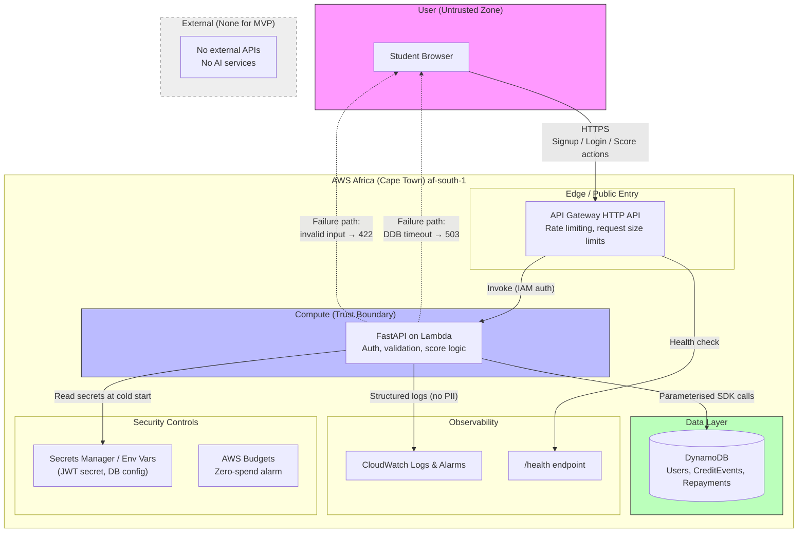

# Credit Gym — Hackathon Engineering Blueprint

**Assumption:** I proceed as a solo Python developer with 24 hours, targeting South African students with zero credit history. The app is a **simulated credit-building experience**, not a real lender, because registering as a credit provider with the National Credit Regulator (NCR) requires CIPC registration, criminal clearance certificates, tax clearance, bank confirmation, and a non-refundable fee—none of which are feasible in 24 hours . The MVP will teach users how credit records work and simulate repayment behavior, clearly labelled as educational.

**Material clarification needed before production:** Will the app ever extend real credit or report to credit bureaus? If yes, the NCR registration and POPIA compliance work below becomes mandatory, not optional.


## 1. Architecture Summary

### Core Function
The single most important function is: **a student completes a simulated “credit-building” cycle (choose a small amount → “repay” it over a defined period → see a credibility score update)**. This delivers the core value proposition—understanding and practising credit behavior—without regulatory exposure.

### Core User Journey
1. Student signs up with email and password.
2. Student views a dashboard showing their simulated credibility score (starting at a baseline).
3. Student selects a small simulated credit amount (e.g., R50–R150) and a repayment term.
4. System records the “credit event” and creates a repayment schedule.
5. Student marks a scheduled payment as “repaid” (simulated).
6. Score updates based on repayment behavior (on-time = positive, missed = negative).
7. Student sees progress and a clear educational disclaimer.

### Major Components
- **Frontend:** A lightweight web UI (server-rendered or minimal SPA) for signup, dashboard, and repayment simulation.
- **Backend API:** Python application handling authentication, score logic, and persistence.
- **Database:** Stores users, simulated credit events, and repayment records.
- **Authentication:** Email/password with hashed credentials and session tokens.
- **Score Engine:** Pure Python business logic module (framework-independent) that calculates credibility scores from repayment events.

### Key Design Decisions
- **No real money movement:** Avoids NCR registration and payment integration complexity.
- **No credit bureau reporting:** Removes need for bureau agreements and POPIA data-sharing assessments for the hackathon.
- **Monolithic deployment:** One deployable unit (web app + API) on a managed platform; no microservices, queues, or AI agents justify their complexity here.
- **Serverless where cheap:** AWS Lambda + API Gateway + DynamoDB fit the free tier and avoid always-on costs .

### What Must Be Built vs. Deferred

| Must Build (Hackathon) | Defer (Post-Hackathon) |
|---|---|
| User signup/login | Password reset flow |
| Credibility score engine | Real credit bureau integration |
| Simulated credit event creation | Real money disbursement |
| Repayment marking + score update | Email/SMS notifications |
| Dashboard with score history | Admin analytics dashboard |
| Basic input validation | Full POPIA data subject access workflow |
| Health check endpoint | Full CI/CD with staging environment |


## 2. Technology Stack

| Layer | Recommendation | Justification |
|---|---|---|
| **Frontend** | **Jinja2 templates + HTMX** (served by the backend) | One language (Python), no separate build step, fast to implement in 24 hours. HTMX gives partial updates without a JS framework. Production could migrate to React if needed. |
| **Backend/API** | **FastAPI** (Python 3.11+) | Async support, automatic OpenAPI docs, Pydantic validation built in, excellent for rapid development. Runs well on Lambda via Mangum. |
| **Database** | **Amazon DynamoDB** (on-demand or provisioned within free tier) | Perpetual free tier: 25 GB storage + 25 RCU/WCU . No RDS provisioning delays. Single-table design fits the simple access patterns. |
| **Authentication** | **Custom email/password with bcrypt + JWT session tokens** (or Amazon Cognito if time permits) | Cognito free tier supports 50,000 MAUs , but adds integration time. Custom auth is faster for a hackathon; Cognito is the production recommendation. |
| **External APIs/AI** | **None for MVP** | No external dependency justifies itself for the core journey. Score logic is deterministic. |
| **Testing** | **pytest** + **httpx** (FastAPI test client) | Standard Python testing; fast to write unit tests for score logic and integration tests for API contracts. |
| **Deployment** | **AWS Lambda + API Gateway (HTTP API)** for backend; **S3 + CloudFront** for static assets if a separate frontend is added later | Lambda free tier: 1M requests/month . API Gateway HTTP API: 1M calls/month first year . No EC2/NAT Gateway costs. |
| **Monitoring** | **CloudWatch Logs** (built-in) + a `/health` endpoint | Free tier includes logs and metrics. Avoid over-engineering with third-party APM in 24 hours. |

**Cost and vendor lock-in notes:**
- **Hackathon cost:** ~$0 if AWS Budgets alarms are set before deployment .
- **Production cost estimate (low traffic):** Still near $0 on the serverless free tiers; DynamoDB on-demand costs appear only under sustained load.
- **Vendor lock-in:** DynamoDB and Lambda are AWS-specific. The FastAPI application code is portable; the deployment configuration is not.
- **Data residency:** AWS Africa (Cape Town) region `af-south-1` is available and opt-in . Use it for POPIA-aligned data residency. **Note:** Opt-in regions require explicit enabling in the AWS account.
- **Free-tier limitation:** API Gateway free tier is 12 months, not perpetual . After 12 months, cost is negligible at hackathon scale but must be budgeted.
- **Prototype shortcut vs. production requirement:** Custom JWT auth is acceptable for demo; production should use Cognito or a managed identity provider with MFA, rotation, and audit logging.


## 3. Mermaid Architecture Diagram



### Component Explanations
- **API Gateway:** The only public entry point. Enforces TLS, rate limits, and request size caps before anything reaches compute.
- **FastAPI on Lambda:** All business logic and validation. Runs inside the trust boundary; treats every request as untrusted until authenticated and validated.
- **DynamoDB:** Stores only the minimum PII needed (email, hashed password, score events). No real financial account numbers.
- **Secrets Manager / Environment Variables:** JWT signing key and configuration. Never in source code.
- **CloudWatch:** Captures structured logs and alarms. Logs must never contain passwords, tokens, or full PII.
- **AWS Budgets:** A $0.01 alarm prevents surprise bills during the hackathon .
- **Failure paths shown:** Database timeout → 503 with generic message; invalid input → 422 with field-level errors. No stack traces to the user.


## 4. Codebase Folder Tree

```
credit-gym/
├── app/
│   ├── main.py                  # FastAPI app factory, middleware, exception handlers
│   ├── config.py                # Settings from env vars (Pydantic Settings)
│   ├── dependencies.py          # Auth dependency, DB client provider
│   ├── models/
│   │   ├── user.py              # User domain model (dataclass or Pydantic)
│   │   ├── credit_event.py      # CreditEvent domain model
│   │   └── repayment.py         # Repayment domain model
│   ├── schemas/
│   │   ├── auth.py              # Signup/Login request/response schemas
│   │   ├── credit.py            # Credit event request/response schemas
│   │   └── common.py            # Shared error response schema
│   ├── services/
│   │   ├── auth_service.py      # Password hashing, JWT creation/verification
│   │   ├── score_engine.py      # PURE logic: calculate score from events
│   │   └── credit_service.py    # Orchestrates credit event + repayment flow
│   ├── repositories/
│   │   ├── user_repo.py         # DynamoDB access for users
│   │   ├── credit_repo.py       # DynamoDB access for credit events/repayments
│   │   └── base.py              # Shared DynamoDB client/config
│   ├── routers/
│   │   ├── auth.py              # POST /auth/signup, /auth/login
│   │   ├── dashboard.py         # GET /dashboard (score + history)
│   │   └── credit.py            # POST /credit/events, POST /credit/repayments
│   ├── templates/               # Jinja2 HTML templates
│   │   ├── base.html
│   │   ├── login.html
│   │   └── dashboard.html
│   └── static/                  # Minimal CSS (no JS framework)
│       └── style.css
├── tests/
│   ├── unit/
│   │   ├── test_score_engine.py # Fast, pure logic tests
│   │   └── test_auth_service.py # Hashing, token logic
│   ├── integration/
│   │   └── test_repositories.py # DynamoDB local or moto
│   └── api/
│       └── test_routes.py       # FastAPI TestClient: auth required, validation
├── migrations/                  # DynamoDB table creation scripts (boto3)
│   └── create_tables.py
├── deployment/
│   ├── template.yaml            # SAM template (Lambda + API Gateway + DynamoDB)
│   └── samconfig.toml
├── .env.example                 # Documented env vars (no real values)
├── requirements.txt             # Pinned dependencies
├── pyproject.toml               # pytest + ruff config
└── README.md                    # Setup and run instructions
```

### Module Responsibilities and Dependency Direction

| Module | Responsibility | Depends On |
|---|---|---|
| `services/score_engine.py` | Pure score calculation. No imports from FastAPI, boto3, or repositories. | Nothing (stdlib only) |
| `services/auth_service.py` | Password hashing and JWT logic. | `config`, external `bcrypt`/`jwt` libs |
| `services/credit_service.py` | Orchestrates: validate user → create event → update score. | `repositories`, `score_engine` |
| `repositories/*` | DynamoDB access only. No business rules. | `config`, boto3 |
| `routers/*` | HTTP concerns: parse request, call service, return response. | `services`, `schemas`, `dependencies` |
| `dependencies.py` | Wires auth and DB clients into routes. | `services/auth_service`, `repositories` |
| `config.py` | Reads env vars. No logic. | Nothing |

**Dependency direction:** Routers → Services → Repositories → Config. The score engine has zero infrastructure dependencies and can be tested in isolation in milliseconds. Routers never call repositories directly.

**Independently developable/testable modules:** `score_engine.py` (pure unit tests), `auth_service.py` (unit tests with known hashes/tokens), `repositories` (integration tests against DynamoDB Local or moto).


## 5. Core API Contracts and Data Model

### DynamoDB Single-Table Design (Minimal)

| Entity | PK | SK | Attributes (minimum) |
|---|---|---|---|
| User | `USER#<userId>` | `PROFILE` | `email`, `password_hash`, `created_at` |
| CreditEvent | `USER#<userId>` | `EVENT#<timestamp>#<eventId>` | `amount`, `term_days`, `status`, `created_at` |
| Repayment | `USER#<userId>` | `REPAY#<eventId>#<due_date>` | `event_id`, `due_date`, `paid_at`, `status` |

**Access pattern:** All queries are by `userId` (from the authenticated session). No cross-user queries. This enforces data ownership at the repository layer.

### API Contracts (MVP Only)

**POST /auth/signup**
- Request: `{ "email": "string", "password": "string (min 8 chars)" }`
- Response 201: `{ "user_id": "string", "email": "string" }`
- Errors: 400 (invalid email/password), 409 (email exists)
- Validation: Email format, password length, request size limit (API Gateway)

**POST /auth/login**
- Request: `{ "email": "string", "password": "string" }`
- Response 200: `{ "access_token": "string", "token_type": "bearer" }`
- Errors: 401 (invalid credentials, generic message)

**GET /dashboard** (requires Bearer token)
- Response 200: `{ "score": int, "events": [ { "event_id", "amount", "status", "created_at" } ] }`
- Errors: 401 (missing/invalid token)

**POST /credit/events** (requires Bearer token)
- Request: `{ "amount_cents": int (5000–15000), "term_days": int (7–30) }`
- Response 201: `{ "event_id", "amount_cents", "term_days", "status": "active" }`
- Errors: 400 (invalid amount/term), 401, 409 (unpaid event exists)

**POST /credit/repayments/{event_id}/mark-paid** (requires Bearer token)
- Response 200: `{ "event_id", "status": "repaid", "new_score": int }`
- Errors: 401, 404 (event not found or not owned by user), 409 (already repaid)

**GET /health**
- Response 200: `{ "status": "ok" }` (no auth, no sensitive info)


## 6. Security and Failure-Handling Matrix

| Risk | Mitigation | Implementation Location | Verification Method |
|---|---|---|---|
| **Broken access control** (user A reads user B’s data) | Every repository call takes `userId` from the authenticated token; never from request body. Deny by default. | `dependencies.py` (extract userId), `repositories/*` (PK prefix enforced) | API test: user A token cannot access user B’s event ID → 404 |
| **Injection (NoSQL)** | Use boto3 parameterised expressions; never concatenate user input into DynamoDB expressions. Pydantic validates types. | `repositories/*`, `schemas/*` | Unit test with malicious strings in fields; confirm no query injection |
| **Weak password storage** | bcrypt with per-user salt and cost factor ≥ 12. | `services/auth_service.py` | Unit test: same password produces different hashes; verify hash |
| **JWT secret exposure** | Read from env var / Secrets Manager at cold start. Never log or return. | `config.py` | Code review; grep for secret in logs during test |
| **PII in logs** | Structured logging with explicit field allowlist. Never log email, password, or token. | `main.py` (middleware), all services | Integration test: capture log output, assert no email appears |
| **Rate limiting / abuse** | API Gateway throttling (e.g., 10 req/s burst 20) | `deployment/template.yaml` | Manual test with rapid requests; confirm 429 |
| **Request size abuse** | API Gateway max payload limit (e.g., 10 KB for MVP) | `deployment/template.yaml` | Manual test with oversized body |
| **Unauthenticated access** | FastAPI dependency rejects missing/invalid token before route logic. | `dependencies.py` | API test: all protected routes return 401 without token |
| **DB unavailability** | Catch boto3 `ClientError`/timeout; return 503 with generic message; log correlation ID. | `repositories/base.py` exception handler | Integration test with mocked timeout → 503, no stack trace |
| **Duplicate repayment** | Conditional write: only mark paid if current status is `pending`. | `repositories/credit_repo.py` | API test: second mark-paid returns 409; score unchanged |
| **Invalid input** | Pydantic schemas with strict types, ranges, and lengths. | `schemas/*` | API test: negative amount, term 0, oversized string → 422 |
| **Malformed external response** | Not applicable (no external APIs in MVP). Deferred. | — | — |
| **Missing config/expired credentials** | Fail fast at startup if required env vars absent. Health endpoint reports degraded if DB unreachable. | `config.py`, `/health` | Test: unset JWT secret → app refuses to start; DB timeout → health returns 503 |

**POPIA-specific considerations (for production, not MVP):**
- Collect only email and a hashed password. No ID numbers, addresses, or bank details.
- Document the lawful basis (consent) and provide a privacy notice.
- Ensure data resides in `af-south-1` .
- Implement data deletion on request before handling real users.

**Remaining risks that must be independently verified:**
- I have **not** verified that the custom JWT implementation is free of vulnerabilities. Use a maintained library (`python-jose` or `PyJWT`) and review its advisories.
- I have **not** verified DynamoDB IAM policy scoping. Confirm the Lambda role can only access the specific table.
- The MVP is **not** production-ready for real financial data. A security review by a qualified engineer is required before any real user PII is processed.
- NCR registration status must be confirmed with a legal advisor before any real lending, even “developmental credit” .


## 7. Testing Plan

| Test Type | Tool | Important Cases | Acceptance Criterion |
|---|---|---|---|
| **Unit: score engine** | pytest | Baseline score; on-time repayment increases; missed repayment decreases; multiple events; boundary values | Pure functions, no I/O, < 1 second runtime, 100% branch coverage of score rules |
| **Unit: auth service** | pytest | Hash differs per call; verify succeeds with correct password; verify fails with wrong; token contains expected claims; expired token rejected | No external calls; deterministic assertions |
| **Integration: repositories** | pytest + moto (mock DynamoDB) | Create user; query by userId; conditional write prevents double repayment; missing item returns None | Tests run without real AWS; isolation between tests |
| **API: routes** | pytest + FastAPI TestClient | Signup → login → create event → mark repaid → dashboard reflects score; unauthenticated → 401; invalid body → 422; cross-user access → 404 | Each route’s contract verified; no real DB needed (mock repo) |
| **Failure path** | pytest | Mock repository raises timeout → route returns 503 with no traceback; duplicate repayment → 409 | No stack traces in response; status codes correct |
| **Security: access control** | pytest | User B token cannot mark User A’s event as paid | Repository query scoped by authenticated userId |
| **End-to-end (manual)** | Browser | Full journey: signup → login → create R100 event → mark repaid → see score increase | Complete in < 2 minutes; no console errors; disclaimer visible |

**What is not tested in the hackathon:** Load testing, penetration testing, POPIA compliance audit, NCR regulatory review. These are explicitly deferred and must be performed before production.


## 8. Deployment Plan

### Hackathon Demo Setup (Target: < 2 hours from empty repo)

1. **Prerequisites:** AWS account with `af-south-1` enabled; AWS SAM CLI installed; Python 3.11.
2. **Create DynamoDB table** via `migrations/create_tables.py` (single table, on-demand billing capped at 25 RCU/WCU).
3. **Set AWS Budgets alarm** at $0.01 before deploying anything .
4. **Deploy backend:** `sam build && sam deploy --guided` → creates Lambda + API Gateway.
5. **Set environment variables** in Lambda configuration: `JWT_SECRET` (generated via `openssl rand -hex 32`), `TABLE_NAME`.
6. **Smoke test:** `curl https://<api>/health` → `{"status":"ok"}`.
7. **Frontend:** Served by the same FastAPI app via Jinja2 templates (no separate deployment needed for MVP). If a static frontend is added later, S3 + CloudFront.
8. **Demo:** Open the API Gateway URL in a browser, complete the journey.

### CI/CD (Deferred to Post-Hackathon)
- GitHub Actions: lint (`ruff`), type check (`mypy`), test (`pytest`), `sam deploy` on tagged release.
- No staging environment for hackathon; production requires one.

### Monitoring and Health
- CloudWatch Logs: structured JSON logs with `request_id`, `level`, `route`, `status_code`. No PII.
- CloudWatch Alarm: Lambda errors > 5 in 5 minutes → SNS email.
- `/health` endpoint: checks DynamoDB connectivity with a bounded timeout.

### Rollback and Recovery
- **Rollback:** `sam deploy` with previous template version. DynamoDB point-in-time recovery enabled (free tier: 35 days? **Unverified**—check current AWS terms; if not free, skip for hackathon and document as a production gap).
- **Backup:** DynamoDB on-demand backups before any schema change. For MVP, data is disposable simulation data.

### Production Gaps (What Must Change Before Real Users)
- Use Amazon Cognito or another managed identity provider instead of custom JWT.
- Enable AWS WAF on API Gateway.
- Implement full POPIA compliance: privacy notice, consent tracking, data deletion, access logging.
- NCR registration and legal review if any real credit is extended .
- Staging environment with separate AWS account.
- Automated dependency scanning and secret scanning in CI.
- Incident response plan and security contact.


## 9. Prioritised Implementation Checklist

Each step is a vertical slice or a prerequisite for the next. **Do not skip tests.**

| # | Step | Prerequisites | Files/Modules | Tests That Must Pass | Acceptance Criterion |
|---|---|---|---|---|---|
| 1 | **Repo skeleton + config** | None | `pyproject.toml`, `requirements.txt`, `config.py`, `.env.example` | `ruff` passes; app imports without error | `python -c "from app.config import settings"` works with env vars set |
| 2 | **Score engine (pure logic)** | Step 1 | `services/score_engine.py`, `tests/unit/test_score_engine.py` | All unit tests for score rules | Baseline → on-time → score up; missed → score down; edge cases covered |
| 3 | **Auth service (hash + JWT)** | Step 1 | `services/auth_service.py`, `tests/unit/test_auth_service.py` | Hash uniqueness; token verify/expiry | Correct password verifies; wrong fails; expired token rejected |
| 4 | **User repository + signup API** | Steps 1–3 | `repositories/user_repo.py`, `routers/auth.py`, `schemas/auth.py`, `tests/api/test_routes.py` | API test: signup 201, duplicate 409, invalid 422 | User persisted; password never returned; token issued on login |
| 5 | **Auth dependency + protected route** | Step 4 | `dependencies.py`, `main.py` middleware | API test: `/dashboard` without token → 401; with token → 200 | Deny-by-default verified |
| 6 | **Credit event creation** | Steps 2, 4, 5 | `repositories/credit_repo.py`, `services/credit_service.py`, `routers/credit.py`, `schemas/credit.py` | API test: create event 201; amount out of range → 422; unpaid event exists → 409 | Event tied to authenticated user; no cross-user visibility |
| 7 | **Repayment + score update** | Step 6 | `services/credit_service.py` (extend), `routers/credit.py` (extend) | API test: mark paid → 200, score changes; double pay → 409; wrong user → 404 | Conditional write prevents double repayment; score reflected in dashboard |
| 8 | **Dashboard read** | Steps 4–7 | `routers/dashboard.py`, `templates/dashboard.html` | API test: dashboard returns score + events for authenticated user only | User sees own data; empty state handled |
| 9 | **Frontend templates** | Steps 4–8 | `templates/*.html`, `static/style.css` | Manual browser test of full journey | Signup → login → create → repay → score visible in < 2 min |
| 10 | **Failure-path hardening** | Steps 4–9 | `main.py` exception handlers, `repositories/base.py` | Tests: DB timeout → 503; no stack trace; malformed JSON → 400 | Generic user-facing errors; structured logs with request ID |
| 11 | **Deployment (SAM)** | Steps 1–10 | `deployment/template.yaml`, `migrations/create_tables.py` | `sam deploy` succeeds; `/health` returns 200 | Public HTTPS endpoint works; budget alarm active |
| 12 | **Demo rehearsal** | Step 11 | README with demo script | Manual end-to-end on deployed URL | Completed twice without errors; disclaimer visible |

**AI assistant instructions (embed in README):** Before each code change, explain the proposed change and which files it touches. Modify only necessary files. Do not replace working code without justification. Run the relevant tests and report actual output. Stop and request human review before changing the data model, weakening auth, or handling secrets.


## 10. Assumptions and Unresolved Risks

### Assumptions
1. **No real lending:** The app is an educational simulator. No money changes hands. This avoids NCR registration for the hackathon .
2. **Single developer, Python:** FastAPI + DynamoDB + Lambda is the fastest coherent stack.
3. **AWS Cape Town region is enabled:** `af-south-1` requires opt-in . The developer must enable it before deployment.
4. **DynamoDB free tier is sufficient:** 25 GB and 25 RCU/WCU are more than enough for a demo .
5. **POPIA compliance is deferred:** No real PII beyond email is collected; a privacy notice is recommended even for the demo.

### Unresolved Risks (Must Verify Before Production)
1. **NCR registration:** If the app ever extends real credit or claims to build “real” credit records, NCR registration is likely mandatory. Fees, documentation, and timelines must be confirmed with the NCR directly .
2. **Credit bureau reporting:** No agreements exist with TransUnion, Experian, etc. The app cannot actually build a real credit score. **This must be made unmistakably clear in the UI.**
3. **POPIA compliance:** A formal assessment is required before processing real user data at scale. The Information Regulator’s guidance on consent, data minimisation, and cross-border transfer (if any data leaves `af-south-1`) must be followed.
4. **Custom auth security:** I have not independently audited the JWT implementation. Use maintained libraries and consider Cognito before production.
5. **DynamoDB IAM scoping:** The Lambda execution role must be restricted to the specific table and actions. Verify with IAM Access Analyzer.
6. **Free-tier expiry:** API Gateway free tier is 12 months, not perpetual . After expiry, costs are small but non-zero. Set a budget alarm.
7. **“Credit gym” branding risk:** Calling a simulator a “credit gym” could mislead users into believing it affects real credit. Use explicit disclaimers on every screen: *“This is an educational simulation. It does not affect your real credit score.”*

**Final engineering principle for this build:** A working, clearly labelled simulator that handles errors honestly is better than a polished demo that implies real credit outcomes it cannot deliver.