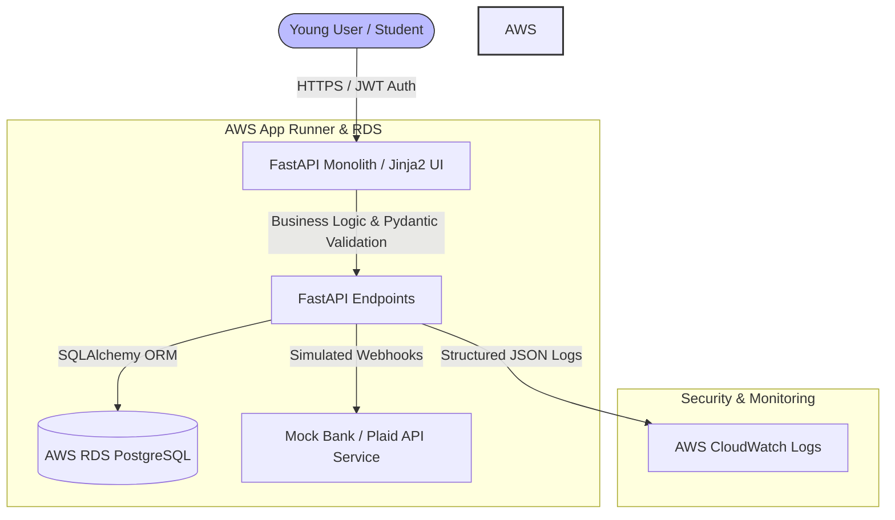

Here is the comprehensive engineering blueprint for the **Credit Gym** hackathon project, designed for a 24-hour sprint by a single developer using Python and AWS.

---

### 1. Architecture Summary

* **Core Function:** A gamified financial fitness tracker that enables students and young adults with a 0 credit score to log verifiable financial habits (such as recurring subscription payments, micro-savings deposits, and financial literacy quizzes) to calculate and build a dynamic **Credibility Score** and export a verifiable credit report.
* **Major Components:**
* **Presentation Layer:** Lightweight server-side rendered HTML/Tailwind CSS templates served directly via FastAPI (minimizing frontend build complexity for a 24-hour timeline).
* **Application/API Layer:** Python FastAPI monolith handling business logic, validation, and score calculation engines.
* **Persistence Layer:** PostgreSQL database managed via SQLAlchemy ORM.


* **Key Design Decisions:**
* *Monolith over Microservices:* Zero network overhead, single deployment artifact, and rapid iteration speed for a 1-person team.
* *Server-side Rendering (SSR):* Eliminates CORS issues, complex frontend state management, and separate Node.js build pipelines.


---

### 2. Technology Stack

| Layer | Recommendation | Justification |
| --- | --- | --- |
| Frontend | Tailwind CSS (CDN) + Jinja2 Templates | Zero build setup, highly responsive UI, rapid prototyping. |
| Backend/API | Python 3.11 + FastAPI | Asynchronous performance, automatic Swagger/OpenAPI docs, rigorous Pydantic data validation. |
| Database | PostgreSQL + SQLAlchemy ORM | Robust relational integrity, easy migration to AWS RDS, native support for constraints and transactions. |
| Authentication | JSON Web Tokens (JWT) + Passlib (Bcrypt) | Stateless, secure session management without complex session store overhead. |
| External APIs/AI | Simulated Bank Webhook / Plaid Mock | Avoids live banking credential hurdles during hackathon while demonstrating real data ingestion. |
| Testing | Pytest + HTTPX | Native Python testing ecosystem, excellent async endpoint testing support. |
| Deployment | AWS App Runner + AWS RDS PostgreSQL | Fully managed container runtime, automatic HTTPS, zero Kubernetes complexity, scales to zero on free tiers. |
| Monitoring | FastAPI Middleware + AWS CloudWatch | Lightweight request/error logging out-of-the-box. |

* **Costs & Limitations:** AWS App Runner offers low base costs with scale-to-zero capabilities. AWS RDS Free Tier covers small PostgreSQL instances for 12 months. POPIA compliance is simulated via data minimization (storing only necessary pseudonymized profile and transaction metadata).

---

### 3. System Architecture Diagram



* **Component Explanations:**
* **User & Frontend:** Initiates HTTP requests via a browser.
* **FastAPI Monolith:** Enforces security headers, validates payloads via Pydantic, and executes credit-scoring algorithms.
* **AWS RDS PostgreSQL:** Stores user credentials, logged financial actions, and calculated scores securely with parameterized queries.
* **CloudWatch:** Captures operational metrics and error stacks safely without leaking internal details to users.


---

### 4. Codebase Folder Tree

```text
credit-gym/
├── .env.example
├── Dockerfile
├── requirements.txt
├── README.md
├── alembic.ini
├── app/
│   ├── __init__.py
│   ├── main.py                  # FastAPI app entrypoint & middleware
│   ├── config.py                # Environment settings (Pydantic BaseSettings)
│   ├── database.py              # SQLAlchemy session & base setup
│   ├── models/                  # Database models
│   │   ├── __init__.py
│   │   ├── user.py
│   │   └── credit_action.py
│   ├── schemas/                 # Pydantic data validation models
│   │   ├── __init__.py
│   │   ├── auth.py
│   │   └── action.py
│   ├── routers/                 # API route handlers
│   │   ├── __init__.py
│   │   ├── auth.py
│   │   ├── dashboard.py
│   │   └── actions.py
│   ├── services/                # Core business logic
│   │   ├── __init__.py
│   │   ├── scoring.py           # Credit gym scoring algorithm
│   │   └── auth_service.py
│   ├── templates/               # Jinja2 HTML views
│   │   ├── base.html
│   │   ├── login.html
│   │   ├── register.html
│   │   └── dashboard.html
│   └── static/                  # CSS / JS assets
│       └── css/
│           └── output.css
├── alembic/                     # Database migrations
│   └── versions/
└── tests/                       # Pytest suite
    ├── __init__.py
    ├── conftest.py
    ├── test_auth.py
    └── test_scoring.py

```

* **Dependency Direction:** `routers` depend on `services` and `schemas`. `services` depend on `models` and `database`. `models` depend on `database`. No circular dependencies are permitted.

---

### 5. Core API Contracts and Data Model

#### Database Schema

1. **Users Table:** `id` (UUID/PK), `email` (String, Unique), `hashed_password` (String), `created_at` (Timestamp).
2. **CreditActions Table:** `id` (UUID/PK), `user_id` (UUID/FK), `action_type` (Enum: `SUBSCRIPTION_PAYMENT`, `MICRO_SAVING`, `FINANCIAL_QUIZ`), `amount` (Numeric), `status` (String), `created_at` (Timestamp).
3. **CreditScores Table:** `user_id` (UUID/PK/FK), `score` (Integer, default 350, max 850), `updated_at` (Timestamp).

#### Key API Endpoints

* `POST /api/auth/register`: Accepts email & password, returns JWT token.
* `POST /api/auth/login`: Authenticates user credentials, returns JWT token.
* `GET /api/dashboard`: Renders user dashboard with current credit score and history.
* `POST /api/actions`: Logs a new credit-building habit (e.g., paying a monthly subscription or saving $10).

---

### 6. Security and Failure-Handling Matrix

| Risk / Scenario | Mitigation Strategy | Implementation Location | Verification Method |
| --- | --- | --- | --- |
| **SQL Injection** | Use SQLAlchemy ORM parameterized queries exclusively. | `app/services/` & `app/routers/` | Automated unit tests with malicious payload strings. |
| **Broken Auth / JWT Theft** | Short token expiration (30 mins), secure HTTP-only cookies or Bearer headers, bcrypt hashing. | `app/services/auth_service.py` | Pytest negative tests with invalid/expired tokens. |
| **Database Unavailability** | Catch connection exceptions, return HTTP 503 with friendly fallback message, avoid exposing stack traces. | `app/main.py` (Global exception handler) | Integration test simulating DB downtime. |
| **Invalid User Input** | Strict Pydantic schema validation on all incoming request payloads. | `app/schemas/` | Automated validation test suite for edge cases. |
| **POPIA / Data Privacy** | Data minimization; store only necessary profile attributes and pseudonymized activity logs. | Database Models & Services | Manual architecture review against compliance checklist. |

---

### 7. Testing Plan

* **Unit Tests (`tests/test_scoring.py`):** Verify that the credit score calculation algorithm correctly increases scores based on consistent actions without exceeding boundaries (350–850).
* **Integration Tests (`tests/test_auth.py`):** Test user registration, password hashing, duplicate email handling, and login token generation using an in-memory SQLite database.
* **API Component Tests:** Verify that protected endpoints reject requests missing valid JWT tokens with an HTTP 401 status code.
* **Acceptance Criteria:** All `pytest` tests must pass successfully before container build and deployment.

---

### 8. Deployment Plan

* **Demo Setup:** Local development using Docker Compose to spin up FastAPI and PostgreSQL simultaneously.
* **CI/CD Pipeline:** GitHub Actions workflow executing linting (`flake8`/`ruff`), type checking (`mypy`), and running the `pytest` suite on every push.
* **Production Gaps for Post-Hackathon:**
* Replace mock bank webhooks with regulated Open Banking / Plaid APIs.
* Introduce an enterprise-grade AWS Secrets Manager configuration instead of environment variables.
* Implement formal rate-limiting middleware (e.g., via Redis).


---

### 9. Prioritised Implementation Checklist

1. **Step 1: Project Setup & Database Configuration**
* *Prerequisites:* Python 3.11, Poetry/Pip, Docker.
* *Files:* `app/database.py`, `app/config.py`, `Dockerfile`.
* *Acceptance:* FastAPI starts successfully and connects to PostgreSQL.


2. **Step 2: Authentication System**
* *Prerequisites:* Step 1 complete.
* *Files:* `app/models/user.py`, `app/schemas/auth.py`, `app/routers/auth.py`, `app/services/auth_service.py`.
* *Acceptance:* Users can register and receive a valid JWT token.


3. **Step 3: Core Credit Action Logic & Scoring Engine**
* *Prerequisites:* Step 2 complete.
* *Files:* `app/models/credit_action.py`, `app/services/scoring.py`, `app/routers/actions.py`.
* *Acceptance:* Logging a financial action correctly updates the user's calculated score.


4. **Step 4: Frontend Dashboard Views**
* *Prerequisites:* Step 3 complete.
* *Files:* `app/templates/dashboard.html`, `app/routers/dashboard.py`.
* *Acceptance:* Authenticated users see their live credit score and activity log rendered in Tailwind CSS.


5. **Step 5: Testing & Final Polish**
* *Prerequisites:* Steps 1–4 complete.
* *Files:* `tests/` directory.
* *Acceptance:* All `pytest` cases pass cleanly, and the app runs smoothly in a Docker container.


---

### 10. Assumptions and Unresolved Risks

* **Assumptions:**
* Mocking credit actions and bank inputs is fully acceptable for the 24-hour hackathon judging criteria.
* Users have internet access to load Tailwind CSS via CDN.


* **Unresolved Risks:**
* Real-world credit scoring requires strict regulatory licensing (such as NCR compliance in South Africa or credit bureau agreements), which is strictly bypassed during this hackathon prototype phase.